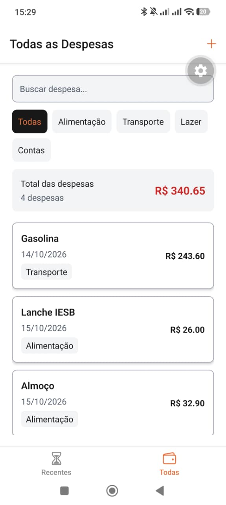
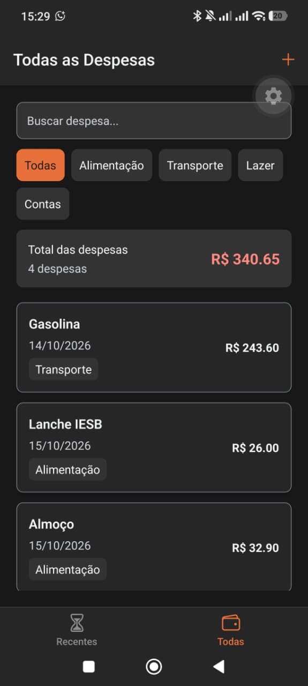
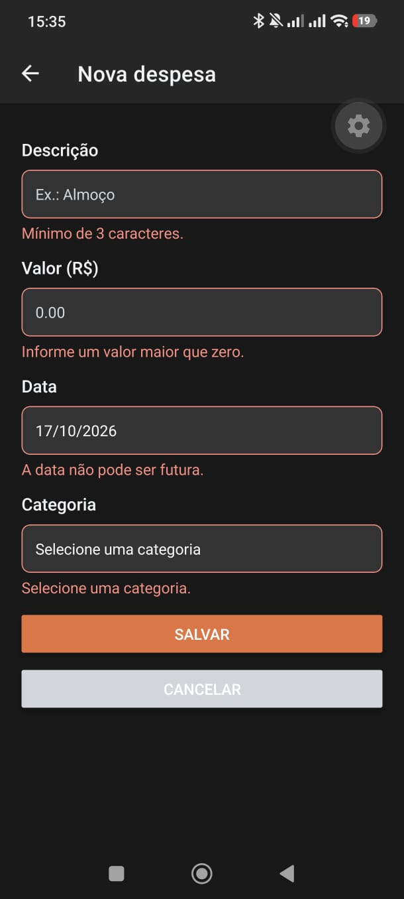
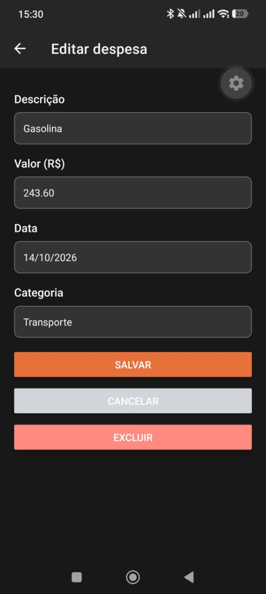

# Prática 09 - Gerenciador de Despesas 2.0

Atividade de Programação para Dispositivos Móveis sobre estado global, formulários e UX.

## Executar

```sh
npm install
npx expo start
```

Projeto para Android e iOS, com Expo SDK 57.

## Funcionalidades

- Context API e useReducer com ADD, UPDATE, DELETE e SET.
- Persistência das despesas no AsyncStorage, com a chave @expenses.
- Cadastro, edição e exclusão com confirmação.
- Formulário com descrição, valor, data e categoria, com validação por campo.
- Seleção de categoria em Modal e data com DateTimePicker.
- Lista de todas as despesas e dos últimos sete dias.
- Busca por descrição com useDebounce e useMemo.
- Quantidade e total acompanhando os filtros.
- Filtro por categoria combinado com a busca.
- Estado vazio com ícone e orientação.
- Tema claro e escuro seguindo o sistema, com laranja, preto e tons de cinza.
- Sombra dos cards adaptada para Android e iOS.

## Estrutura

App.js e src/components, src/constants, src/hooks, src/store, src/screens e src/utils.

O modelo usado é { id, description, amount, date, category }.

## Conferência

1. Abrir sem despesas e conferir o estado vazio.
2. Salvar o formulário vazio e conferir as mensagens.
3. Informar descrição ab, valor 0 e data futura.
4. Corrigir um campo e conferir que apenas seu erro desaparece.
5. Escolher a categoria e salvar uma despesa válida.
6. Editar o valor e conferir as duas abas e os totais.
7. Cancelar uma exclusão e depois confirmar a exclusão.
8. Cadastrar três despesas, fechar completamente o app e reabrir.
9. Buscar ALM para localizar Almoço e conferir quantidade e total.
10. Combinar busca e categoria e buscar um termo sem resultados.
11. Alternar o tema do sistema e conferir a lista e o formulário.
12. Conferir o formulário com o teclado aberto e rolar até Salvar.

## Telas do aplicativo

### Lista no tema claro



### Lista no tema escuro



### Formulário com erros de validação



### Edição de despesa



## Entrega

- Link do pull request.
- Nome e matrícula na descrição do PR.
- Prints da lista nos temas claro e escuro e do formulário com erros.

As pastas node_modules e .expo não fazem parte da entrega.
