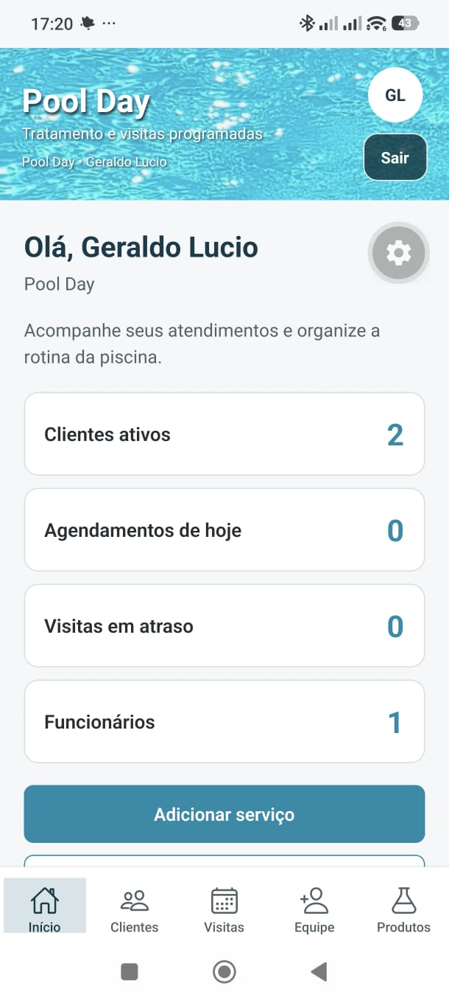
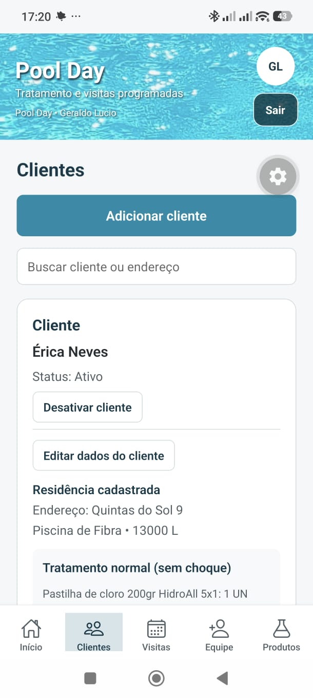
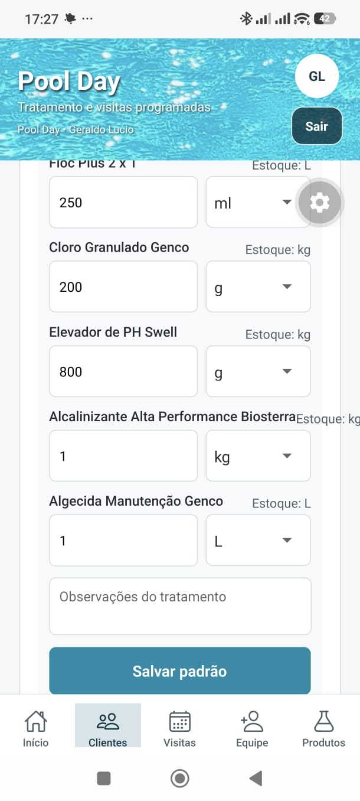
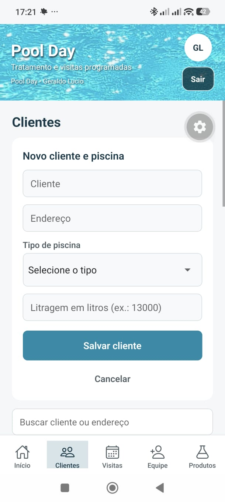
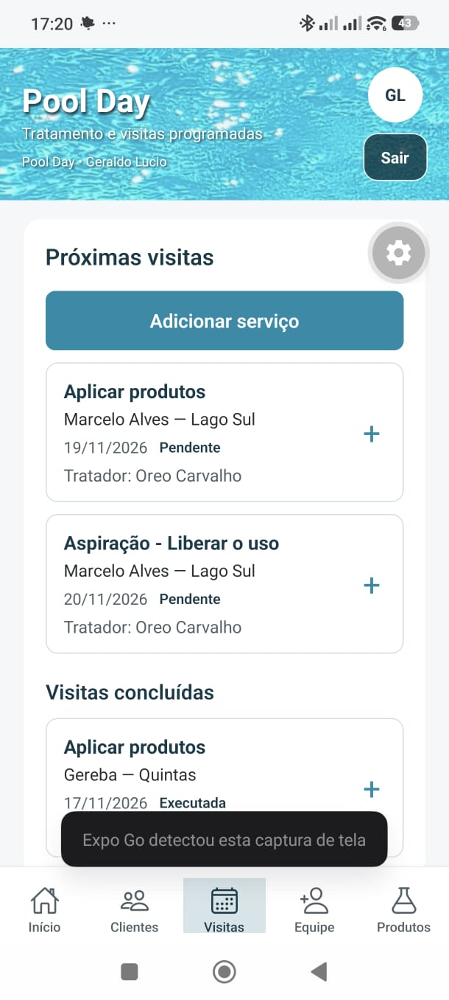
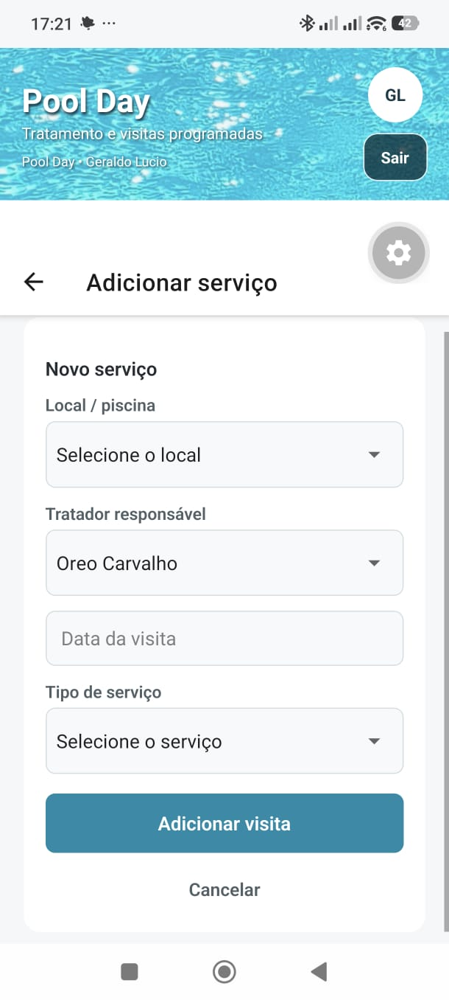
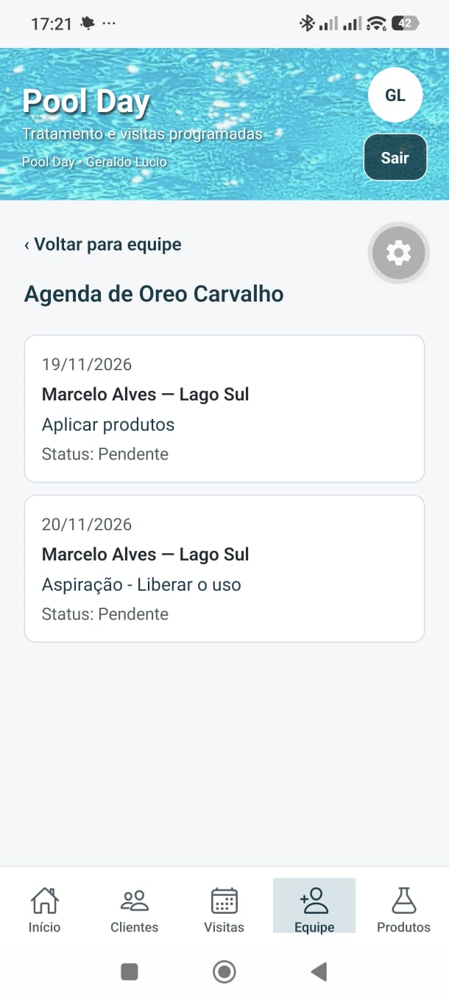
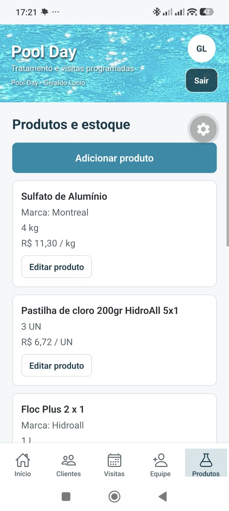
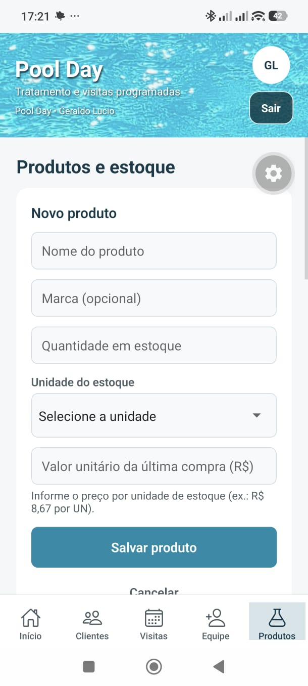
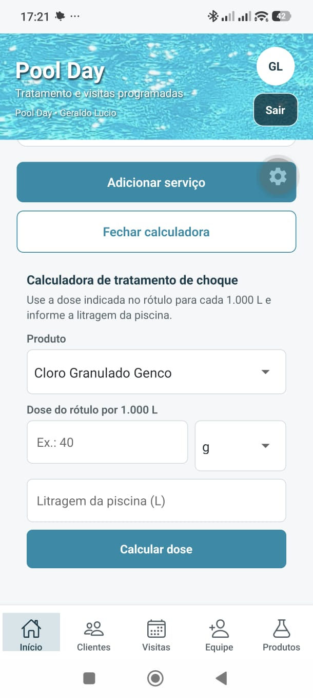

# Pool Day

Aplicativo mobile para ajudar no planejamento e no registro do tratamento de piscinas.

O responsável cadastra clientes, piscinas, produtos e visitas. O tratador registra chegada e saída, localização, fotos antes/depois, pH medido e resultado do atendimento. O aplicativo usa Firebase Authentication e Firestore; as fotos das visitas são enviadas à API do Pool Day.

## Funcionalidades principais

- Painel com clientes ativos, visitas de hoje, atrasos e equipe.
- Cadastro, pesquisa, edição e ativação/desativação de clientes e piscinas.
- Agenda de visitas com data, serviço e tratador responsável.
- Registro do atendimento com horário, localização, fotos e resultado.
- Cadastro de produtos, estoque e orientação de tratamento por piscina.
- Calculadora de dosagem com base na recomendação informada no rótulo.

## Tecnologias usadas

- React Native com Expo.
- React Navigation com Native Stack e Bottom Tabs.
- Context API para compartilhar a sessão autenticada.
- Firebase Authentication e Cloud Firestore.
- Câmera, localização e seletor de data do aparelho.
- Ícones vetoriais de `@expo/vector-icons`.

## Executar o projeto

Instale as dependências com `npm install` e inicie o Expo com `npx expo start`.

Crie o arquivo `.env.local` a partir de `.env.example` e informe as configurações do app Web do Firebase. O endereço da API de fotos já está preenchido no exemplo. Esses arquivos locais não devem ser enviados ao Git.

## Testes

Execute os testes do aplicativo com `npm test`, os testes de autenticação e convite com `npm run test:firebase` e os testes das regras do Firestore com `npm run test:regras`.

## Configurar Firebase

1. Crie um app Web no projeto Firebase e copie os valores para um arquivo `.env.local`, usando o `.env.example` como modelo.
2. No Firebase Authentication, habilite o método de acesso por e-mail e senha.
3. Publique as regras de `firestore.rules` no Firestore antes de testar o cadastro.
4. Na tela inicial, toque em **Cadastre-se** e informe o nome do responsável, o nome da empresa, o e-mail e uma senha. O app cria a conta e vincula perfil, empresa e responsável no Firestore.
5. Depois de entrar, o responsável pode convidar tratadores pela tela Equipe; cada tratador recebe um e-mail para definir a senha.
6. Reinicie o Expo depois de preencher o `.env.local`.

O cadastro inicial cria o responsável e uma nova empresa em uma única operação no Firestore. O responsável pode convidar tratadores e atribuir visitas. O convite cria a conta em uma sessão separada do Firebase Authentication, grava o perfil e o vínculo de membro em uma única operação no Firestore e envia um e-mail para definir a senha. A lista do tratador consulta apenas visitas atribuídas ao UID conectado.

O envio usa o e-mail de redefinição de senha do Firebase Authentication e está sujeito aos limites do plano Firebase em uso. Não é necessário publicar Cloud Functions para cadastrar um tratador.

## Navegação do aplicativo

O fluxo principal usa uma pilha de navegação com abas inferiores. O responsável acessa Início, Clientes, Visitas, Equipe e Produtos. O tratador acessa Início e Minhas visitas. O formulário de nova visita abre como uma tela da pilha e retorna à agenda depois de salvar ou cancelar. A sessão autenticada é disponibilizada às telas pela Context API.

Na tela Início, o responsável acompanha clientes ativos, visitas agendadas para hoje e funcionários, com atalhos para as áreas correspondentes. O cadastro de cliente, o agendamento de visita e o convite de tratador aparecem ao tocar em seus botões; as telas mostram os registros antes dos formulários. A lista de clientes pode ser pesquisada. Clientes começam ativos e podem ser ativados ou desativados na tela Clientes. O responsável também pode editar o nome do cliente e os dados da piscina. O responsável pode atribuir uma visita a si mesmo quando trabalha sem tratadores. Na tela Equipe, o responsável pode abrir a agenda de cada tratador; cada tratador acessa somente as próprias visitas.

Na tela Clientes, cada piscina permite configurar um padrão de tratamento normal (sem choque), com quantidades e unidades informadas pelo responsável para os produtos usados. Ao selecionar “Aplicar produtos” em uma visita, o padrão da piscina é carregado no campo de orientação e pode ser ajustado para aquele atendimento. O aplicativo não define dosagens; elas devem seguir as instruções dos produtos.

## Capturas de tela

### Painel inicial



### Clientes e tratamento padrão



### Edição do padrão de tratamento



### Cadastro de cliente



### Agenda de visitas



### Cadastro de serviço



### Agenda do tratador



### Produtos e estoque



### Cadastro de produto



### Calculadora de produtos



## Integrante e divisão do trabalho

- Geraldo Lucio Carvalho dos Santos — matrícula 2424290069. Projeto individual: definição da proposta, desenvolvimento das telas e funcionalidades, integração com Firebase, testes e documentação.

## Documentação

- [Modelo de empresas e usuários](docs/modelo-empresas-usuarios.md)
- [Testes das regras do Firestore](docs/testes-regras-firestore.md)

## Gerar APK para demonstração

O APK de demonstração é gerado pelo EAS Build com o perfil `preview`. Antes do primeiro build, configure o projeto no EAS e crie no ambiente `preview` as variáveis do `.env.example`, usando os valores do app Firebase de desenvolvimento.

```bash
npx eas-cli@latest build:configure
npx eas-cli@latest build --platform android --profile preview
```

Ao terminar, o EAS fornece um link para baixar e instalar o APK no Android. O perfil `preview` produz APK para instalação direta e apresentação; a publicação na Play Store exige outro formato e configuração.
